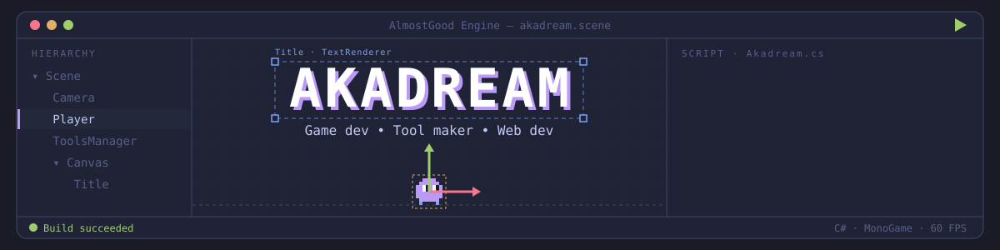

<!-- ============ HEADER ============ -->

  

  

  
  
  
  

<!-- ============ ABOUT ============ -->
## 🧑‍💻 About me

- 🏢 Founder of **Almost Good Studio**, based in France 🇫🇷
- 🛠️ Obsessed with creating tools, currently building my own game engine
- 🎮 Making games mostly with [MonoGame](https://monogame.net) and [Foster](https://github.com/FosterFramework/Foster)
- 🌐 Also working in the web development industry

<!-- ============ SKILLS ============ -->
## 🧰 Skills

  <b>Languages</b>  
  

  <b>Game dev</b>  
  
   
  
  
  
  

  <b>Web &amp; tooling</b>  
  
   
  
  

<!-- ============ GAMES ============ -->
## 🎮 My games on Steam

<table align="center">
  <tr>
    <td align="center" width="50%">
      
       <b>Shaper</b> 
      A 2D dungeon editor: build your own adventure with enemies, items and decor, then share it with the community.
        
      
    </td>
    <td align="center" width="50%">
      
       <b>Tamamoji</b> 
      A little clicker where you take care of an emoji with a changing mood. Keep it alive as long as you can!
        
      
    </td>
  </tr>
</table>

<!-- ============ PROJECTS ============ -->
## 🛠️ Tools & projects

  
  
  
  

**Contributions**: 🖌️ [Gum](https://github.com/vchelaru/Gum), a flexible layout tool for creating UI on any platform.

<!-- ============ GITHUB ACTIVITY ============ -->
## 📊 GitHub activity

  
  

  

  <picture>
    <source media="(prefers-color-scheme: dark)" srcset="https://raw.githubusercontent.com/akaadream/akaadream/output/github-contribution-grid-snake-dark.svg"/>
    <source media="(prefers-color-scheme: light)" srcset="https://raw.githubusercontent.com/akaadream/akaadream/output/github-contribution-grid-snake.svg"/>
    
  </picture>

